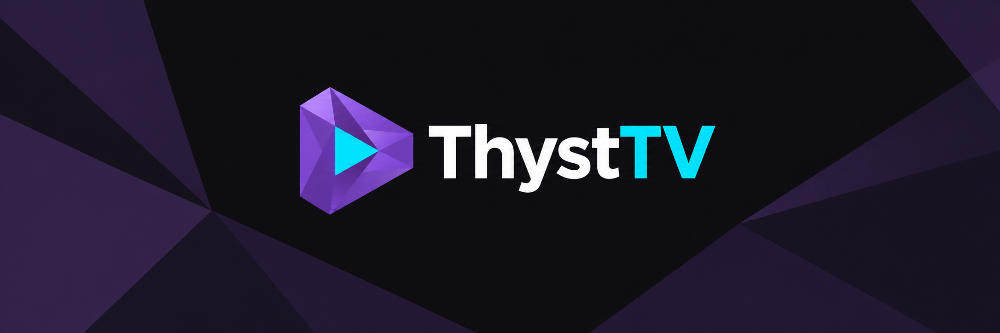
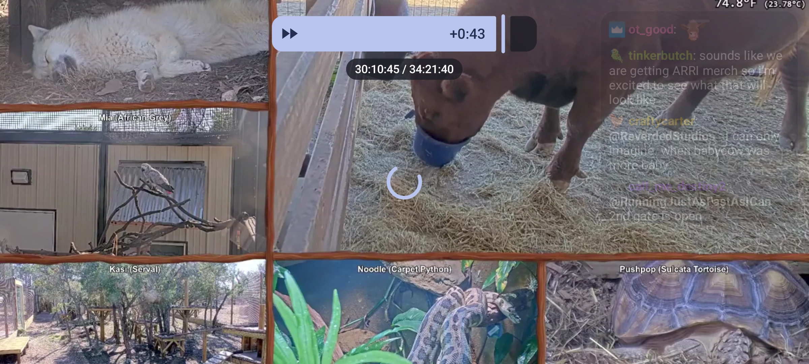
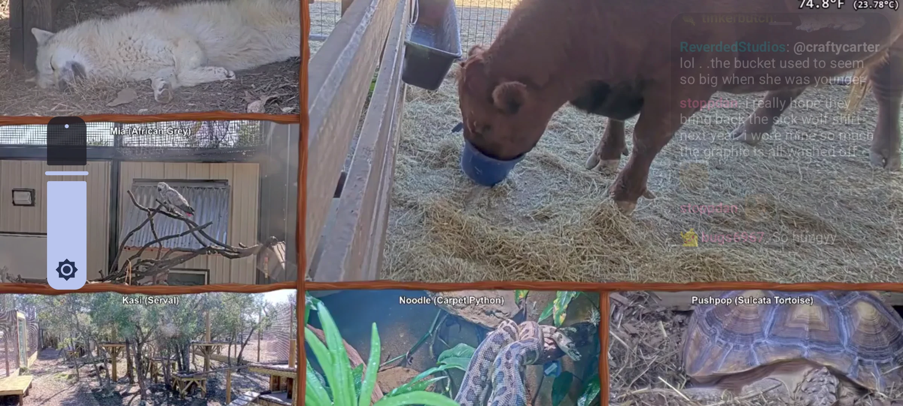
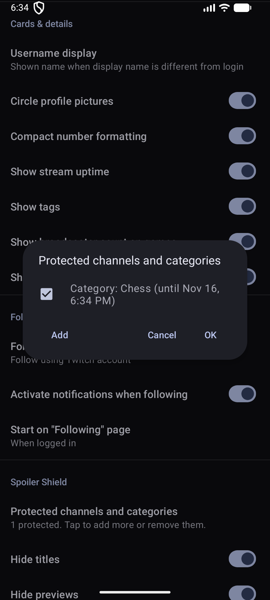
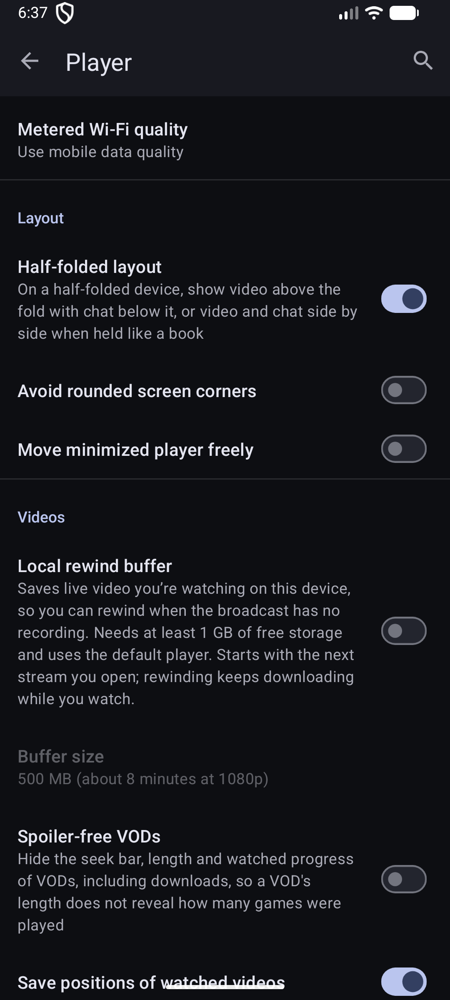
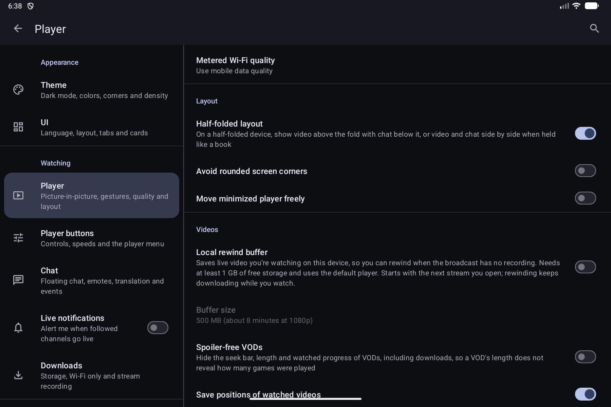
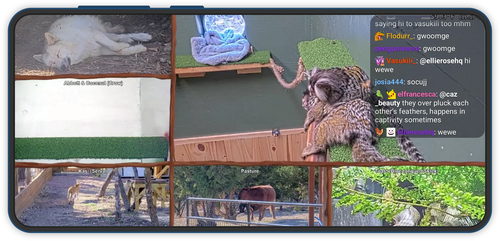
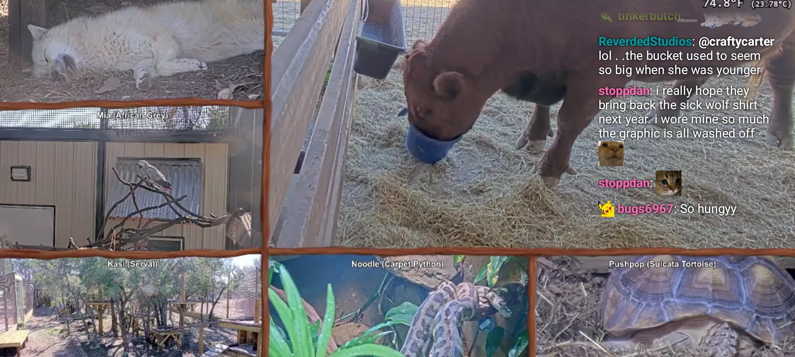
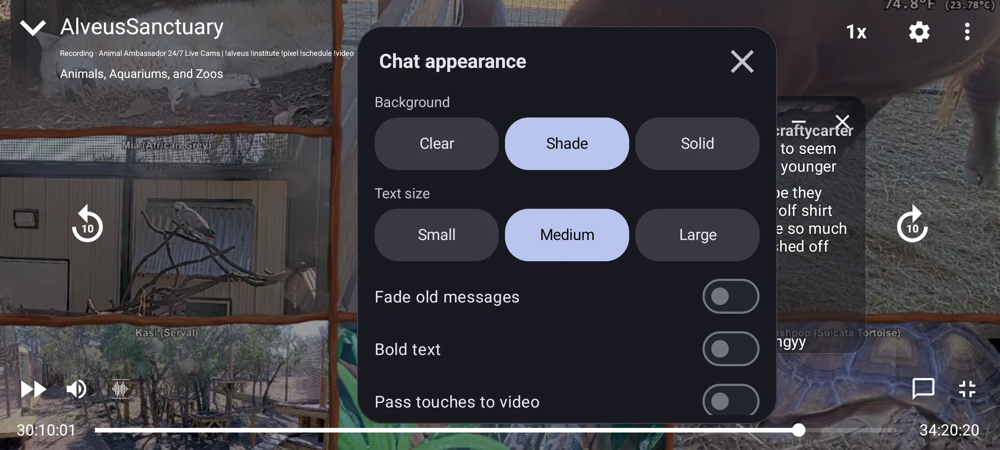
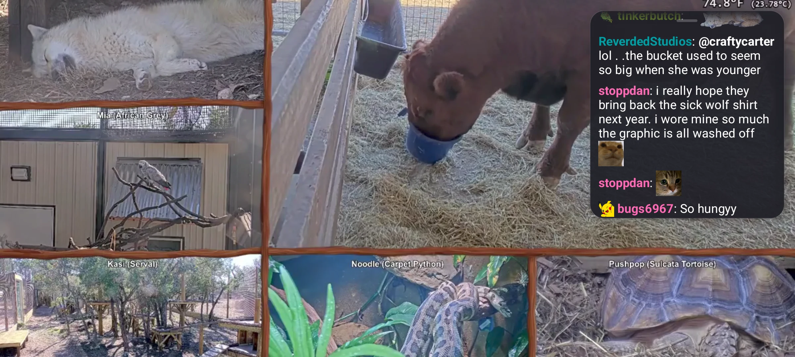

<p align="center">
  
</p>

<h1 align="center">ThystTV</h1>

<p align="center">
  An open-source Twitch client for Android, with polished playback, floating chat, local viewing stats, and large-screen layouts.
</p>

<p align="center">
  <a href="https://github.com/tzii/ThystTV/releases/latest"></a>
  <a href="https://github.com/tzii/ThystTV/actions/workflows/ci.yml"></a>
  <a href="https://github.com/tzii/ThystTV/blob/master/LICENSE"></a>
  
</p>

<p align="center">
  <a href="#screenshots">Screenshots</a>
  ·
  <a href="#what-thysttv-adds">Features</a>
  ·
  <a href="#build-from-source">Build</a>
  ·
  <a href="#credit">Credit</a>
</p>

---

## What is ThystTV?

**ThystTV** is a third-party Twitch client for Android. It is based on [Xtra](https://github.com/crackededed/Xtra), with ThystTV-specific work aimed at making the viewing experience cleaner, faster, and more comfortable on phones, tablets, and large displays.

The **1.7.0 update** redesigns player gesture feedback with Material 3 Expressive sliders and a centered-number option, smooths brightness, volume and accelerating VoD seek gestures, keeps chat reconnecting over weak connections, preserves sign-in across 2FA app switches, and refines Settings, portrait live controls, Cast stop controls and clip links/downloads. See the [1.7.0 release notes](docs/release-notes/1.7.0.md) for changes, limitations and upgrade guidance, or [download the latest official signed APK](https://github.com/tzii/ThystTV/releases/latest).

> ThystTV is a fork of Xtra. A lot of credit goes to the Xtra project for the foundation this app builds on.

## Screenshots

Native captures on an Android 16 emulator: the player from a 1.7.1 test build ([capture details](docs/images/features-1.7/README.md)) and 1.6 screens ([capture details](docs/images/features-1.6/README.md)).

<table>
  <tr>
    <td width="50%" align="center" valign="top">
      <strong>Seek slider</strong><br><br>
      
    </td>
    <td width="50%" align="center" valign="top">
      <strong>Brightness at the edge</strong><br><br>
      
    </td>
  </tr>
</table>

<table>
  <tr>
    <td width="50%" align="center" valign="top">
      <strong>Spoiler Shield</strong><br><br>
      
    </td>
    <td width="50%" align="center" valign="top">
      <strong>Local live rewind</strong><br><br>
      
    </td>
  </tr>
</table>

<p align="center">
  <strong>Two-pane Settings on wide windows</strong><br><br>
  
</p>

[Watch the new Spoiler Shield recording](docs/images/features-1.6/spoiler-shield.mp4): apply a timed category rule and review it in the manager. The recording is silent and uses an anonymous emulator.

## Floating chat

Floating chat keeps chat on screen during full-screen playback, so the video doesn't have to shrink into a split layout. In 1.7.1 it is a rounded card: drag it by the thin bar at its top to anywhere on screen, right up to the edges, and resize it from the corner grip while the player controls show. Each channel remembers its size and spot. Pick Clear, Shade or Solid from **Aa**; menus open above the card, and it fades back during gesture sliders.

<p align="center">
  <a href="docs/images/features-1.7/floating-chat.mp4"></a>
</p>

<table>
  <tr>
    <td width="33%" align="center" valign="top">
      <strong>Clear</strong><br><br>
      
    </td>
    <td width="33%" align="center" valign="top">
      <strong>Aa</strong><br><br>
      
    </td>
    <td width="33%" align="center" valign="top">
      <strong>Solid</strong><br><br>
      
    </td>
  </tr>
</table>

<p align="center">
  <a href="docs/images/features-1.7/floating-chat.mp4">Watch the floating chat demo (MP4, silent)</a> · <a href="docs/images/features-1.7/README.md">Capture details</a>
</p>

## What ThystTV adds

### Playback and live rewind

- VoD seek previews when Twitch provides storyboards, fast scrubbing, saved positions and replay chat.
- Swipe for seek, speed, brightness and volume. Swipe sideways in landscape to show or hide chat.
- Pinch between Fit and Fill; enable extended zoom to magnify further and drag the picture.
- Rewind through the broadcast's recording, including **Watch last 3 minutes**, then return with Go live.
- Optional **local rewind buffer** for streams without a recording: 250 MB–2 GB, default player only, at least 1 GB free storage. It keeps video from the current viewing session and clears shortly after leaving; it does not keep replay chat.
- Exact quality picks by resolution, frame rate, codec and bitrate, including a metered Wi-Fi default. Quality, Speed, Stream volume and More use consistent overlays.
- A 16:9 mini-player, background audio, and optional read-only live chat below portrait PiP video.

### Spoilers and clips

- **Spoiler Shield** hides titles and previews for selected channels or categories until removed, or for 24 hours, 3 days or 7 days. Reveal an individual item when ready.
- Shielded titles stay hidden across supported lists, the player and notifications. Chat and shared links remain outside the shield; notification changes during playback apply at the next stream start.
- **Spoiler-free VoDs** hide lengths, seek bars and watched progress, including downloads. System media controls may still show length.
- Create a **5–60 second live clip**, then watch it in ThystTV, copy, share or open Twitch's editor. TV approval happens on another device. Requires sign-in and clip permission; captures the live broadcast, not a rewind position or a VoD.

### Chat and notifications

- Floating chat over full-screen video in Clear, Shade or Solid: drag it anywhere and resize it from the corner, with its size and spot remembered per channel; third-party emotes and chat replay remain available.
- Redeem custom Channel Points rewards after an explicit confirmation.
- Live notifications respect per-channel settings and avoid repeat alerts.
- Poll and prediction timers account for time spent asleep, and event cards survive chat screen rebuilds.

### Phones, foldables and TV

- Half-folded layouts put video above the hinge or beside chat in book posture.
- Two-pane Settings on windows at least 840dp wide; compact screens keep one pane.
- Android TV D-pad navigation and sign-in from a phone with a QR or activation code.
- **Experimental Google Cast**, off by default: live streams and clips with the default player, Google Play services and a compatible receiver on the same network. VoDs and downloads play on the phone. Keeping receiver playback after closing the app is a separate opt-in setting.

### Local stats, downloads and updates

- On-device viewing time, favorite channels, category breakdowns and streaks.
- Video downloads with compact progress indicators and local playback.
- In-app update checks, rendered release notes and links to the GitHub release.
- New sign-in grants preserve the current account until confirmed.

## Build from source

Recommended local setup:

- Android Studio, current stable release
- JDK 21
- Android SDK matching the project configuration

```bash
./gradlew assembleDebug
./gradlew test
./gradlew assembleRelease
```

On Windows:

```powershell
.\gradlew.bat assembleDebug
.\gradlew.bat test
.\gradlew.bat assembleRelease
```

## Download and install

Download the latest APK from [GitHub Releases](https://github.com/tzii/ThystTV/releases/latest). Each release includes an APK checksum; verify the package, checksum, and official signing certificate with the [APK verification guide](docs/APK_VERIFICATION.md) before installing or upgrading.

ThystTV is distributed independently. It is not affiliated with, endorsed by, or sponsored by Twitch Interactive or Amazon.

## Documentation

- [Roadmap](docs/ROADMAP.md)
- [Testing guide](docs/TESTING.md)
- [Manual QA](docs/MANUAL_QA.md)
- [Player notes](docs/PLAYER.md)
- [Gesture system](docs/GESTURE_SYSTEM.md)
- [Release process](docs/RELEASE_PROCESS.md)
- [1.6.0 release notes](docs/release-notes/1.6.0.md)
- [1.5.2 release notes](docs/release-notes/1.5.2.md)
- [1.5.0 release notes](docs/release-notes/1.5.0.md)
- [1.4.0 release notes](docs/release-notes/1.4.0.md)
- [1.3.1 release notes](docs/release-notes/1.3.1.md)
- [Distribution policy](docs/DISTRIBUTION.md)
- [APK verification guide](docs/APK_VERIFICATION.md)
- [Security policy](SECURITY.md)
- [Upstream sync policy](docs/UPSTREAM_SYNC.md)
- [Upstream sync ledger](docs/UPSTREAM_SYNC_LEDGER.md)
- [Visual identity](docs/VISUAL_IDENTITY.md)

## Contributing

Contributions should stay focused, reviewable, and easy to test. For UI work, include screenshots. For player or gesture changes, include manual test notes for live playback, VoDs, orientation changes, and minimize/restore behavior. Report bugs through [GitHub Issues](https://github.com/tzii/ThystTV/issues).

Read [CONTRIBUTING.md](CONTRIBUTING.md) before opening a non-trivial pull request.

## Credit

ThystTV is based on [Xtra](https://github.com/crackededed/Xtra). The upstream project deserves major credit for the base client, architecture, and years of work that made this fork possible.

## License

ThystTV is licensed under the [GNU Affero General Public License v3.0](LICENSE).
