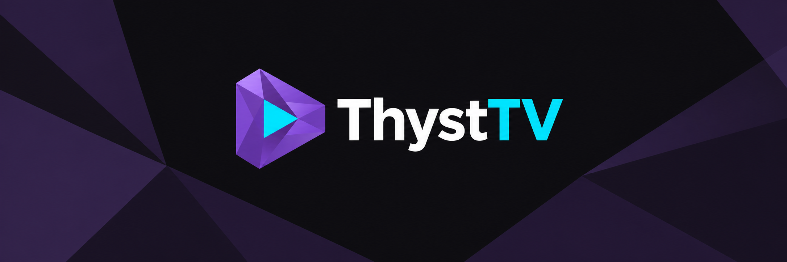
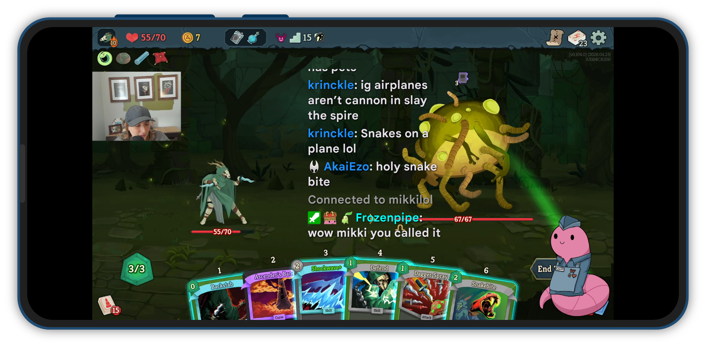

<p align="center">
  
</p>

<h1 align="center">ThystTV</h1>

<p align="center">
  An open-source Twitch client for Android, with polished playback, floating chat, local viewing stats, and large-screen layouts.
</p>

<p align="center">
  <a href="https://github.com/tzii/ThystTV/releases/latest"></a>
  <a href="https://github.com/tzii/ThystTV/actions/workflows/ci.yml"></a>
  <a href="https://github.com/tzii/ThystTV/blob/master/LICENSE"></a>
  
</p>

<p align="center">
  <a href="#screenshots">Screenshots</a>
  ·
  <a href="#what-thysttv-adds">Features</a>
  ·
  <a href="#build-from-source">Build</a>
  ·
  <a href="#credit">Credit</a>
</p>

---

## What is ThystTV?

**ThystTV** is a third-party Twitch client for Android. It is based on [Xtra](https://github.com/crackededed/Xtra), with ThystTV-specific work aimed at making the viewing experience cleaner, faster, and more comfortable on phones, tablets, and large displays.

The **1.4.0** release adds live rewind, free pinch zoom, Channel Points rewards, a half-folded layout for foldables, exact quality selection, and an optional spoiler-free mode for VoDs. It also refreshes Settings and the updater. See the [1.4.0 release notes](docs/release-notes/1.4.0.md) for changes and upgrade guidance, or [download the official signed APK](https://github.com/tzii/ThystTV/releases/tag/v1.4.0).

> ThystTV is a fork of Xtra. A lot of credit goes to the Xtra project for the foundation this app builds on.

## Screenshots

Version 1.3 layouts, rendered with sample data ([how they were made](docs/images/review-1.3/README.md)).

<table>
  <tr>
    <td width="50%" align="center" valign="top">
      <strong>Video quality</strong><br><br>
      
    </td>
    <td width="50%" align="center" valign="top">
      <strong>Playback speed · enlarged text</strong><br><br>
      
    </td>
  </tr>
</table>

<table>
  <tr>
    <td width="50%" align="center" valign="top">
      <strong>Local Stats</strong><br><br>
      
    </td>
    <td width="50%" align="center" valign="top">
      <strong>Updater and release notes</strong><br><br>
      
    </td>
  </tr>
</table>

## Floating chat

Floating chat keeps chat on screen during full-screen playback, so the video doesn't have to shrink into a split layout. The demo below is from a version before 1.3.

<p align="center">
  
</p>

https://github.com/user-attachments/assets/99d97579-3340-4200-8aa7-3cae0414560e

<p align="center">
  <a href="docs/images/readme/floating-chat.mp4">Download the floating chat demo video</a>
</p>

## What ThystTV adds

### Player refinement

- Gesture-based playback controls for horizontal seek, playback speed, brightness, and volume.
- Pinch to any zoom between Fit and Fill in landscape, with Stretch available in display settings.
- Rewind a live stream to its recording with replay chat, then return with Go live.
- Exact quality picks by resolution, frame rate, codec and bitrate, with a separate metered Wi-Fi default.
- An optional spoiler-free mode that hides VoD lengths and watched progress.
- On a half-open foldable, video above the hinge with chat below, or side by side in book posture.
- Quality, Speed, Stream volume and More share consistent overlays with reachable controls.
- Clearer feedback while interacting with the player.
- Better visual handling for minimized player states.
- VoD scrubbing improvements that scale with video duration.

### Floating chat

- Chat overlay designed for full-screen viewing.
- A cleaner way to keep stream context visible while the video remains primary.
- Better fit for phones, tablets, and wide layouts.

### Chat and notifications

- Redeem a channel's custom Channel Points rewards from chat after an explicit confirmation.
- Live notifications follow each channel's notification setting and avoid repeat alerts.

### Local stats

- Watch-history and screen-time insights.
- Category breakdowns and viewing patterns.
- Favorite channel and session-focused views.
- Stats stay local on the device.

### Updater and changelog

- In-app update checks with release details.
- Changelog previews before downloading a new build.
- Direct links to the GitHub release when more context is needed.

### Large-screen comfort

- Layout work for tablets and wider Android screens.
- Player and browsing screens tuned to avoid cramped controls.
- Player menus and Stats adapt to enlarged text and resized windows.

## Build from source

Recommended local setup:

- Android Studio, current stable release
- JDK 21
- Android SDK matching the project configuration

```bash
./gradlew assembleDebug
./gradlew test
./gradlew assembleRelease
```

On Windows:

```powershell
.\gradlew.bat assembleDebug
.\gradlew.bat test
.\gradlew.bat assembleRelease
```

## Download and install

Download the latest APK from [GitHub Releases](https://github.com/tzii/ThystTV/releases/latest). Each release includes an APK checksum; verify the package, checksum, and official signing certificate with the [APK verification guide](docs/APK_VERIFICATION.md) before installing or upgrading.

ThystTV is distributed independently. It is not affiliated with, endorsed by, or sponsored by Twitch Interactive or Amazon.

## Documentation

- [Roadmap](docs/ROADMAP.md)
- [Testing guide](docs/TESTING.md)
- [Manual QA](docs/MANUAL_QA.md)
- [Player notes](docs/PLAYER.md)
- [Gesture system](docs/GESTURE_SYSTEM.md)
- [Release process](docs/RELEASE_PROCESS.md)
- [1.4.0 release notes](docs/release-notes/1.4.0.md)
- [1.3.1 release notes](docs/release-notes/1.3.1.md)
- [Distribution policy](docs/DISTRIBUTION.md)
- [APK verification guide](docs/APK_VERIFICATION.md)
- [Security policy](SECURITY.md)
- [Upstream sync policy](docs/UPSTREAM_SYNC.md)
- [Upstream sync ledger](docs/UPSTREAM_SYNC_LEDGER.md)
- [Visual identity](docs/VISUAL_IDENTITY.md)

## Contributing

Contributions should stay focused, reviewable, and easy to test. For UI work, include screenshots. For player or gesture changes, include manual test notes for live playback, VoDs, orientation changes, and minimize/restore behavior. Report bugs through [GitHub Issues](https://github.com/tzii/ThystTV/issues).

Read [CONTRIBUTING.md](CONTRIBUTING.md) before opening a non-trivial pull request.

## Credit

ThystTV is based on [Xtra](https://github.com/crackededed/Xtra). The upstream project deserves major credit for the base client, architecture, and years of work that made this fork possible.

## License

ThystTV is licensed under the [GNU Affero General Public License v3.0](LICENSE).
